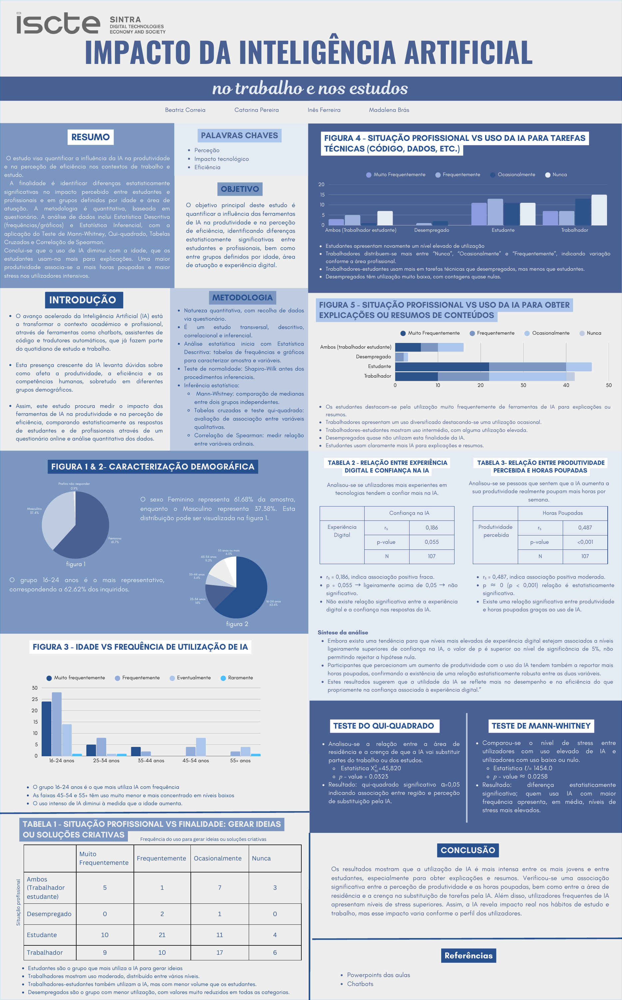

# Impacto da Inteligência Artificial no trabalho e nos estudos

Projeto da unidade curricular de Estatística Aplicada (Licenciatura em Matemática Aplicada e Tecnologias Digitais, Iscte, 2025/26).

Criámos e aplicámos um questionário online para perceber como a IA influencia a produtividade e a perceção de eficiência de estudantes e profissionais, e se há diferenças entre grupos de idade, situação profissional e região.

## Amostra

- **142 inquiridos** na amostra total, usada na caracterização sociodemográfica.
- **107 utilizadores de IA**, a subamostra usada na análise dos padrões de utilização e nos testes.

## Métodos

- Estatística descritiva: tabelas de frequências e gráficos.
- Teste de normalidade de Shapiro-Wilk, para justificar o uso de testes não paramétricos.
- Correlação de Spearman entre variáveis ordinais.
- Teste do qui-quadrado de independência e tabelas cruzadas.
- Teste de Mann-Whitney entre dois grupos independentes.

## Principais resultados

| Pergunta | Resultado |
|---|---|
| Experiência digital vs. confiança na IA | rₛ = 0,186; p = 0,055. Associação fraca, não significativa a 5%. |
| Produtividade percebida vs. horas poupadas por semana | rₛ = 0,487; p < 0,001. Associação moderada e significativa. |
| Área de residência vs. crença de que a IA vai substituir tarefas | χ² = 45,82 (30 g.l.); p = 0,0323. Associação significativa a 5%. |
| Stress em utilizadores intensivos vs. de uso baixo ou nulo | U = 1454; p ≈ 0,026. Os utilizadores intensivos reportam, em média, mais stress. |

Também observámos que o uso de IA diminui com a idade e que os estudantes a usam mais para obter explicações e resumos.



## O código

`analise.py` reproduz a parte do trabalho feita em Python: o teste de Shapiro-Wilk e as duas correlações de Spearman da tabela acima.

```bash
pip install pandas scipy openpyxl
python analise.py respostas.xlsx
```

As respostas do questionário **não estão neste repositório**, porque são dados de inquiridos que participaram com consentimento informado. O script espera um ficheiro Excel com as colunas das quatro perguntas que usa (experiência com tecnologias digitais, confiança nas respostas da IA, aumento de produtividade e horas poupadas por semana).

## Autoras

Beatriz Correia, Catarina Pereira, Inês Ferreira e Madalena Brás.
